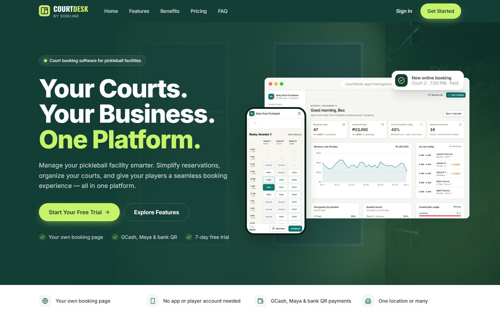
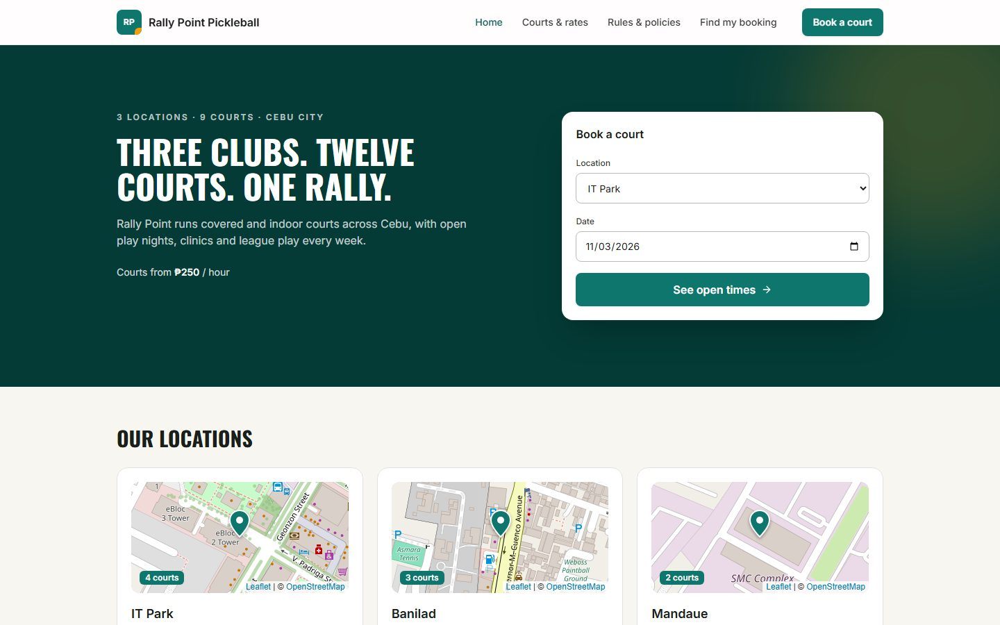
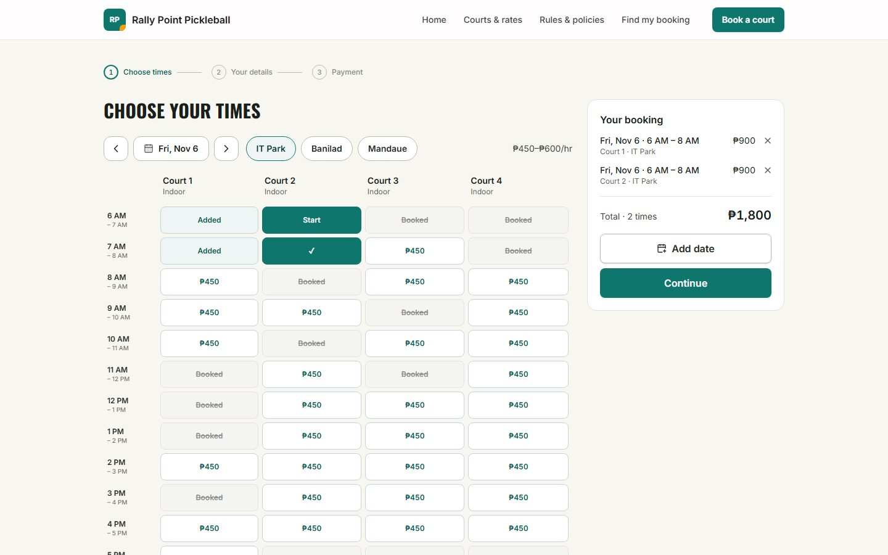
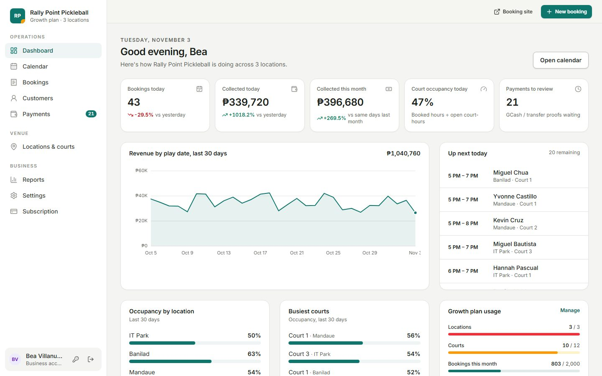
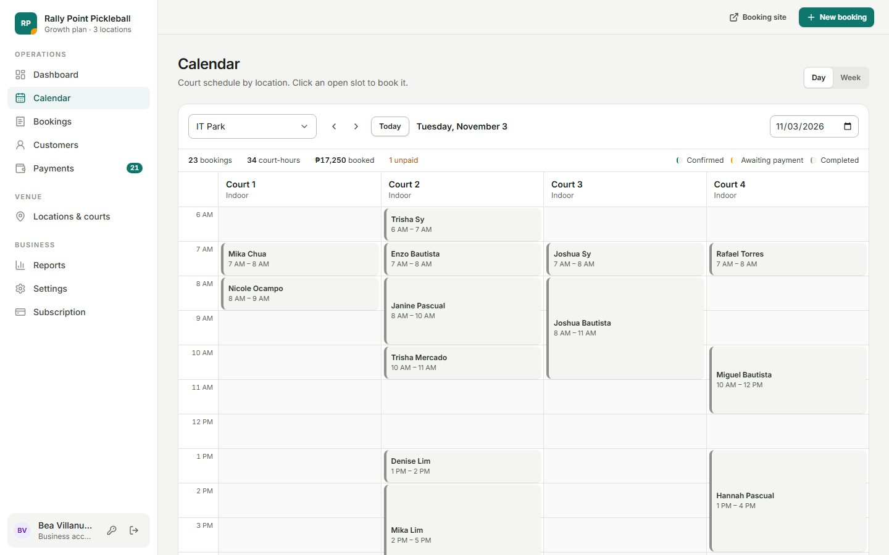
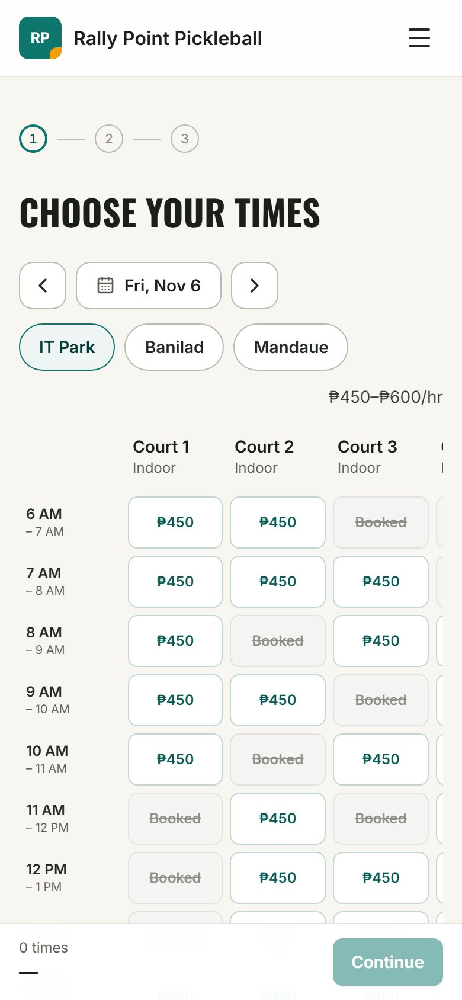
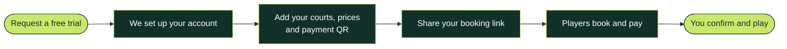

# CourtDesk

**Court booking software for pickleball facilities** 
Your courts. Your business. One platform. — _by Sideline_

[What it does](#-what-it-does) · [Screenshots](#-screenshots) · [How it works](#-how-it-works) · [Plans](#-plans)

 

 

## 🏓 What is CourtDesk?

CourtDesk is an online booking system made for pickleball courts in the
Philippines. Each facility gets **its own booking website** where players can see
open courts and book them any time, plus a **simple dashboard** to run the
business day to day.

No more back-and-forth messages, double bookings or paper schedules: players book
and pay on their own, and the court owner sees everything in one place.

## ✨ What it does

<table>
  <tr>
    <td width="33%" valign="top">
      <h3>For players</h3>
      <ul>
        <li>See open courts and prices in real time</li>
        <li>Book several courts, times and dates at once</li>
        <li>Pay with GCash, Maya or a bank QR code</li>
        <li>No app to download, no account needed</li>
        <li>Look up a booking any time</li>
      </ul>
    </td>
    <td width="33%" valign="top">
      <h3>For court owners</h3>
      <ul>
        <li>A branded booking site with your logo, colours and photos</li>
        <li>A calendar of every court and every booking</li>
        <li>Day and night rates for each court</li>
        <li>Confirm payments, refunds and changes in a tap</li>
        <li>Customer list, daily earnings and reports</li>
        <li>Rules that stop no-shows and bulk bookings</li>
      </ul>
    </td>
    <td width="33%" valign="top">
      <h3>For growing clubs</h3>
      <ul>
        <li>One location or many</li>
        <li>Your own house rules and policies on the site</li>
        <li>Walk-in and phone bookings alongside online ones</li>
        <li>Start with a free trial, upgrade any time</li>
      </ul>
    </td>
  </tr>
</table>

## 📸 Screenshots

<table>
  <tr>
    <td width="50%"></td>
    <td width="50%"></td>
  </tr>
  <tr>
    <td align="center"><b>Your booking site</b> · your locations, courts and prices</td>
    <td align="center"><b>Booking a court</b> · pick courts and times, see the total</td>
  </tr>
  <tr>
    <td width="50%"></td>
    <td width="50%"></td>
  </tr>
  <tr>
    <td align="center"><b>Your dashboard</b> · money collected and today's games</td>
    <td align="center"><b>Calendar</b> · every court at a glance</td>
  </tr>
</table>

<b>📱 See it on a phone</b>

 

## 🧭 How it works

1. **Request a free trial** — tell us about your facility.
2. **We set up your account** for you.
3. **Add your courts** — opening hours, day and night rates, and your GCash, Maya or bank QR.
4. **Share your booking link** — on Facebook, Messenger, or a QR code at the front desk.
5. **Players book and pay** — they send payment straight to you and upload the receipt.
6. **You confirm** — one tap, and the court is theirs.

## 💳 Plans

|                    | **Starter** | **Growth** ⭐ |   **Pro**   |   **Custom**    |
| ------------------ | :---------: | :-----------: | :---------: | :-------------: |
| Per month          |    ₱999     |    ₱1,799     |   ₱3,999    |    By quote     |
| Locations          |      1      |       3       |      6      | Your own system |
| Courts             |      4      |      12       |     30      |                 |
| Bookings per month |     400     |     2,000     |  Unlimited  |                 |
| Free trial         |     ✅      |      ✅       | Coming soon |   Talk to us    |

Every plan includes your own booking site, the court calendar, day and night
rates, GCash and cash payments, a customer list and your own branding.
Pay yearly and get two months free.

**Custom** is for facilities that want booking software built just for them,
with their own website address.

 

**Ready to get your courts online?** 
Start your free trial — no payment needed.

 

<b>CourtDesk</b> is made by <b>Sideline</b> · Made in the Philippines 🇵🇭

